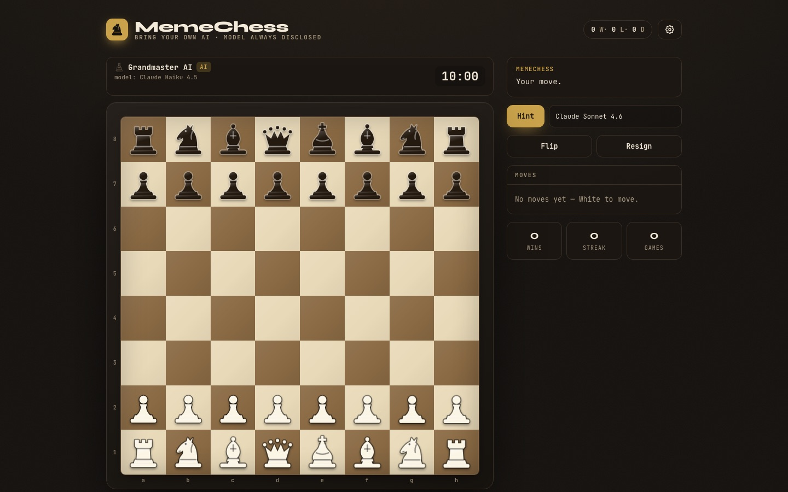

# MemeChess

MemeChess is an online chess game that lets you play in the browser against AI opponents (Claude or any Anthropic-compatible model) with swappable meme skins, for casual players who want a fun, transparent chess-vs-LLM experience on desktop or mobile web.



Live demo: https://www.ichess.lol (also at https://memechess.vercel.app)

Online chess with **swappable meme skins** and **bring-your-own-AI opponents** — built serverless for Vercel, playable on web and mobile web.

The twist: everyone can play against *any* model they want, on a **time limit**, and **the model each side uses is always disclosed to both players**. There's no vision pipeline — the board is streamed to the model as pure text (`FEN + ASCII + legal moves`), which is cheap, fast, and transparent.

## Features

- **14 meme skins** — Grandmaster, `root@chess` terminal, Skibidi, 6‑7, Huh Cat, Italian Brainrot (Tralalero), Doge, GigaChad, Autobahn (car/racing), Vaporwave, Stonks, Labubu, Nyan, Noir Royale. Each skin re-paints the board, background, fonts, piece treatment **and the AI's trash-talk vocabulary**. Shareable links: `/?skin=skibidi`.
- **Hand-drawn Staunton piece set** — a layered inline-SVG set (outline pass, fill pass, sheen, line-work) with real king/bishop/knight profiles, no emojis, no image files, nothing to 404. Restyled per skin via CSS variables (fill/outline/glow/sheen).
- **Framed board** — rank/file coordinates in the frame gutter, surfaced squares with a soft vignette, capture bursts, check pulse, slide-in moves, and a staggered piece drop on every new game.
- **Material tracking** — each player strip shows the pieces they've captured and their pawn-value lead.
- **Three modes**
  - **You vs AI** — pick your color, opponent model, and difficulty.
  - **Local 2‑player** — pass-and-play on one device.
  - **AI vs AI** — watch two different models battle; both models are labeled on-screen.
- **Bring your own AI** — plays out of the box with the built-in provider, or paste your own Anthropic-compatible base URL + key (sent per-request to the serverless proxy, never stored server-side).
- **Real chess rules** via `chess.js` — legal moves, checks, castling, en passant, promotion, checkmate/stalemate/repetition/50-move/insufficient-material.
- **Per-side chess clocks** (Bullet/Blitz/Rapid or no clock) that enforce the AI's time limit.
- **Score tracking** — a stable per-browser player ID records your W/L/D, streak, and games.
- **Clean, lightweight UI** — the board is the hero; chrome stays quiet. Fully responsive.

## How it works / Tech stack

- **Next.js (App Router) + React + TypeScript**
- `chess.js` for rules & state
- One serverless route: `app/api/ai-move/route.ts` (Anthropic-compatible)
- No image assets — pieces are a generated inline-SVG set (`components/PieceSvg.tsx`)

## Getting started (run locally)

```bash
npm install
npm run dev
# http://localhost:3000
```

The app reads its default AI provider from `.env.local`:

```bash
ANTHROPIC_BASE_URL="https://api.anthropic.com"
ANTHROPIC_AUTH_TOKEN="sk-..."
```

Players can override both from the in-game **Bring your own API key** panel.

## Project structure

```
app/
  page.tsx              # home page (the game) + JSON-LD
  layout.tsx            # metadata, fonts, site URL
  api/ai-move/route.ts  # serverless AI move endpoint (Anthropic-compatible)
components/
  GameApp.tsx           # game shell: modes, clocks, settings, scores
  Board.tsx             # the chess board
  PieceSvg.tsx          # inline-SVG Staunton piece set
lib/
  ai.ts                 # client call to /api/ai-move
  models.ts             # selectable AI models
  themes.ts             # the meme skins
  storage.ts            # per-browser player ID and W/L/D stats
  sound.ts, pieces.ts
public/llms.txt         # site summary for LLMs
```

## Deploy to Vercel

```bash
vercel            # link & deploy a preview
vercel --prod     # production
```

Set `ANTHROPIC_BASE_URL` and `ANTHROPIC_AUTH_TOKEN` as Vercel environment variables (Project → Settings → Environment Variables). The serverless route runs on the Node.js runtime.

## Transparency & fairness (the house rules)

1. **Disclosure** — the model powering each side is shown in that side's player strip and in the AI-vs-AI setup.
2. **Time limit** — every side has a clock; a model that runs out of time forfeits, and each request is bounded by the remaining time.
3. **Pure-text state** — models receive `FEN + ASCII + legal SAN moves`. If a model returns an illegal or malformed move, the server falls back to a random *legal* move so the game never stalls (and the fallback is flagged).

## Roadmap

- Real-time online multiplayer (currently local + AI). Needs a realtime backend (e.g. a WebSocket service or serverless pub/sub) + a shared game store — the client is already structured around a single `Chess` source of truth to make this a drop-in.
- Cross-device accounts / global leaderboard (swap `lib/storage.ts` for API-backed persistence).
- Per-skin sound packs.
